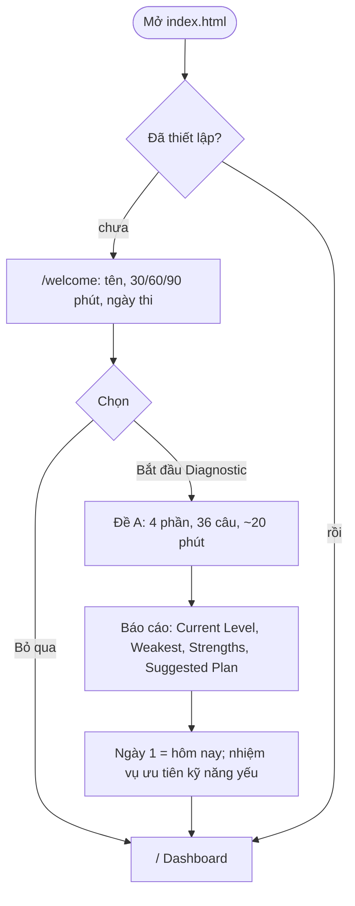
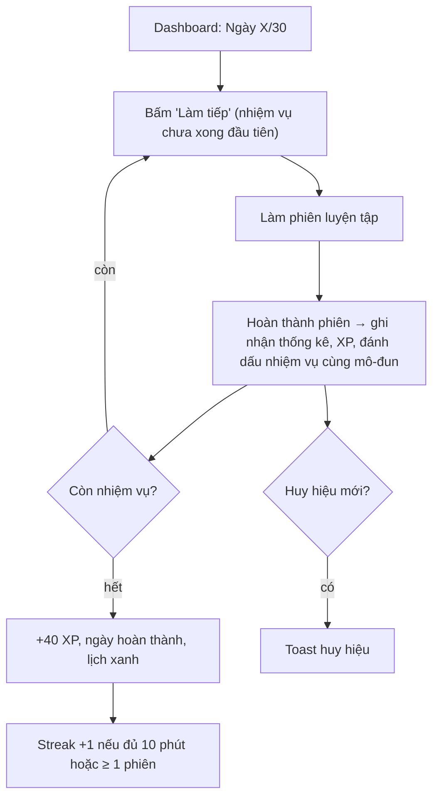
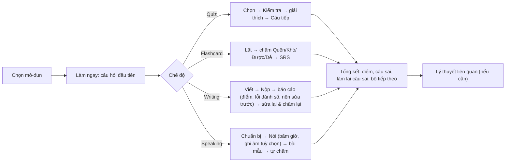
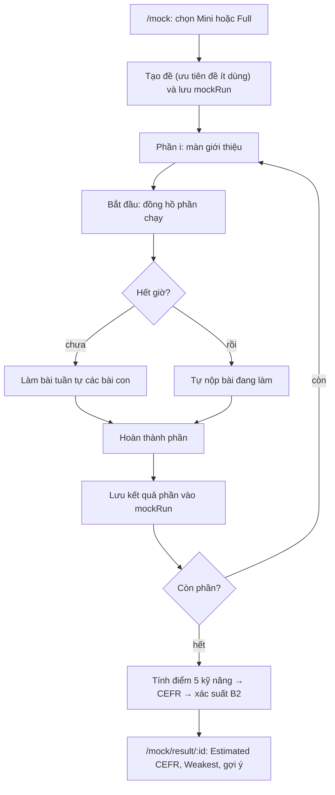

# 3. User Flow

## 3.1 Lần đầu truy cập → có kế hoạch

## 3.2 Vòng lặp hằng ngày

Nếu bỏ lỡ ngày: lịch hiện ô đỏ; người học vẫn làm được mọi ngày qua `Lộ trình → Ngày N` và đánh dấu thủ công; "hôm nay" luôn là ngày dương lịch kể từ Ngày 1 (có thể đặt lại Ngày 1 trong Cài đặt).

## 3.3 Phiên luyện tập (Practice First)

## 3.4 Mock Test

- Thoát giữa chừng: tiến độ giữ ở mức phần đã xong; phần đang làm dở làm lại từ đầu khi quay lại (`/mock` hiện nút "Tiếp tục").
- Writing: sau khi nộp có **báo cáo tự động** (điểm ước tính, lỗi, việc nên sửa) và bài mẫu; trong Mock bấm "Tiếp tục" để sang bài sau (không sửa lại). Speaking: bài mẫu rồi **tự chấm**, điểm nhân 0,9.

## 3.5 Diagnostic cuối (Ngày 30)
Ngày 30 giao Đề B (cùng độ khó, câu khác). Báo cáo so với Đề A: điểm tuyệt đối, % thay đổi, đạt/chưa đạt tiêu chí +20% (hoặc ≥ 90/100).

## 3.6 Sao lưu & khôi phục
`Cài đặt → Sao lưu` tải file JSON; `Khôi phục` ghi đè toàn bộ dữ liệu (có hộp thoại xác nhận); `Xoá toàn bộ` đưa về trạng thái lần đầu.
