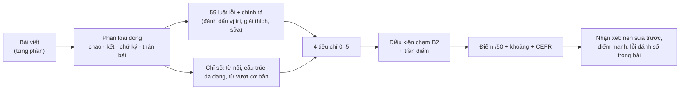

# 12. Chấm & nhận xét Writing offline

Viết cho: người phát triển/chủ sản phẩm quyết định có tin, chỉnh hay thay bộ chấm này không.

## 12.1 Bối cảnh và quyết định
Bản v1.0 để người học **tự chấm** Writing (nhân hệ số 0,9). Cách đó yếu: người học không biết mình sai ở đâu và thường chấm cao. Để chấm "như giáo viên" có ba hướng:

| Hướng | Ý tưởng | Tình trạng |
|---|---|---|
| **B. Bộ luật offline** | Phát hiện lỗi điển hình + đo chỉ số ngôn ngữ, quy ra 4 tiêu chí và điểm /50 | **Đã làm (tài liệu này)** |
| A. AI chấm theo rubric | Gửi bài cho mô hình ngôn ngữ, nhận điểm + nhận xét | **Chưa làm có chủ ý** — repo public, không được nhúng khoá API (xem 12.10) |
| C. Giáo viên thật | Xuất bài, giáo viên chấm, nhập điểm lại | **Đã làm ở mức nhập tay** (12.7) |

Hướng B chạy hoàn toàn trên máy người học: **không AI, không mạng, không gửi bài đi đâu**.

## 12.2 Nó làm được gì — và không làm được gì
**Làm được:** đếm và đánh giá độ dài/bố cục/giọng văn; bắt ~60 loại lỗi điển hình của người học Việt (chia động từ, thì, mạo từ, giới từ, kết hợp từ, chính tả, dấu câu…) kèm lời giải thích tiếng Việt và chủ điểm ngữ pháp để ôn; đo từ nối, độ đa dạng cấu trúc, vốn từ vượt mức cơ bản; cho điểm 4 tiêu chí + điểm /50 với khoảng tin cậy; nói rõ **điều gì đang giữ điểm dưới B2**; nhớ lỗi lặp lại qua các bài; cho sửa lại và chấm lại để thấy tiến bộ.

**Không làm được:** hiểu nghĩa, đánh giá ý tưởng/lập luận/giọng điệu tinh tế; bắt mọi lỗi ngữ pháp (chỉ bắt lỗi nằm trong danh sách luật); phân biệt C1/C2; thay giám khảo Aptis. Vì vậy điểm luôn được ghi là **"ước tính tự động"** và luôn kèm khoảng tin cậy.

## 12.3 Quy trình

Mã: `js/core/writing-analyzer.js` (không chạm DOM, chạy được trong Node), nhật ký `js/core/writing-log.js`, giao diện `WritingTask` trong `js/ui/tasks.js`.

## 12.4 Bốn tiêu chí
Điểm tổng = `0,20·HT + 0,30·NP + 0,25·TV + 0,25·LK` (thang 0–5) × 10.

| Tiêu chí | Trọng số | Đo bằng |
|---|---|---|
| **Hoàn thành yêu cầu** (HT) | 0,20 | Độ dài so với yêu cầu · cấu trúc thư (chào, kết, nêu mục đích, đề nghị, chia đoạn) hoặc (chat) có lý do/ý kiến/nhiều câu · độ phủ từ khoá của đề · giọng văn đúng loại thư |
| **Ngữ pháp** (NP) | 0,30 | Độ chính xác: số lỗi có trọng số trên 100 từ (nhẹ 0,6 · vừa 1 · nặng 1,5), chiết khấu khi bài ngắn · độ phong phú: tổng trọng số các họ cấu trúc (nâng cao = 1: điều kiện, bị động, modal hoàn thành, nhượng bộ, tường thuật…; cơ bản = 0,5: quan hệ, hoàn thành, nguyên nhân, so sánh, thời gian) · trừ khi câu quá ngắn |
| **Từ vựng** (TV) | 0,25 | Độ đa dạng (chỉ số Guiraud) · **tỉ lệ từ vượt ngoài vốn từ cơ bản** (A1–A2) · thưởng từ B2/C1 trong kho và kết hợp từ tự nhiên · trừ chính tả, dùng từ sai, từ chung chung (very, good, thing…) |
| **Liên kết & bố cục** (LK) | 0,25 | Số loại từ nối B2 (however, although, as a result…) theo độ dài bài · cụm diễn ngôn tự nhiên · đa dạng cách mở câu · độ dài câu · chia đoạn (Task 4) |

Task 1: các ô điền 1–5 từ chấm riêng theo độ đầy đủ, độ dài và lỗi; câu 20–30 từ được phân tích như văn bản.

## 12.5 Bộ luật lỗi
59 luật (43 ngữ pháp · 6 dùng từ · 7 dấu câu & viết hoa · 3 giọng văn) + bảng ~185 lỗi chính tả hay gặp (kiểm trước) + bộ bắt gõ nhầm độc lập (so với kho từ của chính ứng dụng; chỉ xét đảo chữ, thiếu/thừa chữ, nhầm nguyên âm; từ ≥ 5 chữ). Máy không có từ điển hệ thống nên không có kiểm tra chính tả đầy đủ.

Ví dụ: `she go` · `I am agree` · `Yesterday I go` · `didn't went` · `have go` · `can to` · `everybody like` · `two year` · `I want read` · `it broken` · `work in company` · `discuss about` · `explain me` · `look forward to hear` · `a apple` · `informations` · `although … but` · lỗi viết hoa · thiếu dấu cách sau dấu câu.

**Nguyên tắc: ưu tiên độ chính xác (precision) hơn độ phủ (recall).** Báo nhầm một lỗi làm người học mất tin; bỏ sót thì chỉ làm điểm hơi cao. Mọi luật có ca dương tính và ca âm tính trong `tests/analyzer.js`, và bộ luật phải cho **0 cảnh báo** trên ~200 đoạn văn tiếng Anh tự nhiên của ứng dụng (~8.000 từ) và trên 16 bài mẫu B2.

**Thêm luật mới:** (1) thêm `R('id', cat, sev, regex, message, fix, { topic, test })` vào `RULES` và nhãn vào `RULE_LABEL`; (2) thêm ít nhất một ca dương và một ca âm vào `POS`/`NEG` trong test; (3) chạy `npm test` — nếu luật báo nhầm trên văn bản tự nhiên thì sửa luật, không nới test.

## 12.6 Điều kiện chạm B2, trần điểm, độ tin cậy
Giáo viên không cho B2 nếu thiếu một mảng quan trọng, nên bộ chấm cũng vậy: **thiếu bất kỳ điều kiện nào thì điểm bị chặn ở 37,4 (đỉnh B1)** và lý do được nêu cụ thể ("Để lên B2: …").

| Điều kiện để ≥ 38 | Ngưỡng |
|---|---|
| Hoàn thành yêu cầu ≥ 3,8/5 | luôn áp dụng |
| Vốn từ | từ vượt vốn cơ bản ≥ 10% bài, hoặc ≥ 3 từ/kết hợp từ B2 trong kho |
| Liên kết (Task 2–4) | ≥ 1 từ nối B2 (bài < 130 từ) hoặc ≥ 2 (dài hơn); cụm thư mẫu chỉ tính tối đa 1 |
| Cấu trúc (Task 2–4) | tổng trọng số ≥ 1 (bài ngắn) / 1,5; vốn từ rất phong phú (≥ 18%) bù cho bài ngắn |
| Độ chính xác | ≤ 5 đơn vị lỗi/100 từ |

Thêm: bài viết < 60% độ dài yêu cầu bị chặn ở 30; < 35% bị chặn ở 20. **Không bao giờ trả về mức C** (trần 43,9): luật không phân biệt được C1/C2.

Khoảng tin cậy: ±5 điểm nếu < 50 từ; ±4 nếu < 100 từ; ±3 nếu < 150 từ; ±2,5 nếu dài hơn. Hiển thị dạng "ước tính B1–B2, khoảng 31–41" và "độ tin cậy: thấp (bài ngắn)".

## 12.7 Đường dẫn cho giáo viên thật
Trong báo cáo (chế độ luyện):
- **Xuất bài cho giáo viên (.md):** đề, bài làm từng phần, ước tính tự động và **phiếu chấm trống** (4 tiêu chí 0–5 + nhận xét). Tệp chứa bài viết của học viên — người học tự quyết gửi cho ai.
- **Nhập điểm giáo viên:** 4 điểm 0–5 + nhận xét → điểm giáo viên = cùng công thức trọng số, và **được ưu tiên hơn điểm tự động** trong Dashboard, Analytics, ước tính trình độ. Sửa lại bài thì điểm giáo viên cũ bị xoá (không còn áp dụng cho bản mới).
- **Đối chiếu:** trang Writing hiện "độ lệch tuyệt đối trung bình" và thiên lệch giữa bộ chấm và giáo viên trên các bài đã có điểm giáo viên; có nút **xuất dữ liệu hiệu chỉnh** (chỉ điểm, **không kèm bài viết**) để người phát triển chỉnh bộ chấm.

## 12.8 Kiểm chứng đã làm — và chưa làm
Kết quả hiện tại (`tests/analyzer.js`, 152 kiểm tra; `tests/smoke.js` có luồng Writing đầu-cuối):

| Nhóm bài | Số bài | Điểm /50 | Kỳ vọng |
|---|---|---|---|
| Bài người học giả lập mức A2 | 6 | 15,2 – 23,2 | < 26 ✓ |
| Bài người học giả lập mức B1 | 6 | 31,8 – 37,4 | 26 – 37,4, không lên B2 ✓ |
| Bài người học giả lập mức B2 | 3 | 43,9 (trần) | ≥ 38 ✓ |
| 16 bài mẫu B2 của ứng dụng | 16 | 35,7 – 43,9 (trung vị 42,5) | ≥ 13/16 bài ≥ 38 ✓ (13/16) |

Thử độ nhạy: bỏ hết từ nối → tiêu chí LK giảm ≥ 1; cắt còn 40% → điểm ≤ 30; thêm 4 lỗi điển hình → bắt đủ và NP giảm ≥ 0,6; thư trang trọng viết kiểu thân mật → ≥ 3 cảnh báo giọng văn. Chính tả: 0 báo nhầm trên 279 từ đúng ít gặp. Các lỗi nằm trong bảng (42/42 lỗi thử) đều bị bắt; **bộ bắt gõ nhầm độc lập** (cho lỗi ngoài bảng) bắt **31/39 (79%)** lỗi thử và cả 31 gợi ý đều đúng — nghĩa là vẫn bỏ sót khoảng 1/5 lỗi gõ nhầm lạ. Hiệu năng: lần đầu ~200 ms (dựng từ điển), các lần sau ~14 ms/bài 135 từ.

**Giới hạn của chứng cứ — đọc kỹ:**
- "Bài người học giả lập" **do người phát triển tự viết**, nhãn A2/B1/B2 là kỳ vọng của người viết, **không phải kết quả chấm của giáo viên**. Chúng chứng minh bộ chấm nhất quán và phân biệt được mức độ, **không chứng minh độ khớp với giám khảo Aptis**.
- Ngưỡng và trọng số được chỉnh để các nhóm bài trên tách nhau — có nguy cơ khớp riêng với tập nhỏ này (overfitting).
- 3 trong 16 bài mẫu B2 chỉ được 35,7–37,6 (bài ngắn, ít từ nối): cho thấy bộ chấm có thể **chấm thấp** văn phong B2 ngắn gọn.
- Chưa có phép đo thống kê nào với điểm giáo viên thật.

## 12.9 Giao thức hiệu chỉnh với giáo viên (việc tiếp theo)
1. Thu 30–50 bài viết thật (nhiều trình độ, đủ 4 task) và nhờ **ít nhất 2 giáo viên** chấm độc lập theo cùng 4 tiêu chí (dùng phiếu chấm xuất từ ứng dụng).
2. Nhập điểm vào ứng dụng, xuất dữ liệu hiệu chỉnh (không kèm bài).
3. Tính: sai số tuyệt đối trung bình (MAE) trên thang 50, thiên lệch, hệ số tương quan, QWK theo mức CEFR; so với độ lệch giữa hai giáo viên làm mức chuẩn.
4. Chỉnh trọng số/ngưỡng/luật trên một nửa dữ liệu, **kiểm trên nửa còn lại** để tránh khớp riêng.
5. Tiêu chí chấp nhận gợi ý: MAE ≤ 4 điểm và cùng mức CEFR trong ≥ 70% bài; nếu không đạt, giữ nhãn "ước tính" và khoảng tin cậy rộng.

## 12.10 Còn chấm bằng AI thì sao?
Chưa làm vì **repo public**: không được nhúng khoá API vào mã. Nếu làm sau này cần: (a) mỗi người dùng tự cung cấp khoá của họ, hoặc một máy chủ trung gian giữ khoá có giới hạn lượt dùng; (b) khoá **không bao giờ** vào repo, file sao lưu hay xuất dữ liệu; (c) chỉ bật khi người dùng chủ động, kèm thông báo bài viết sẽ gửi ra ngoài; (d) giữ bộ chấm offline làm mặc định và dự phòng; việc đếm từ vẫn do mã làm; (e) đánh giá lại bằng đúng bộ bài ở 12.9.

## 12.11 Dữ liệu và riêng tư
Khoá LocalStorage `wlog` (schema ở [04](04-database-schema.md)): tối đa 80 lần chấm, chỉ 40 lần gần nhất giữ nội dung bài viết. Sao lưu JSON chứa nội dung bài viết — là dữ liệu cá nhân. Không có yêu cầu mạng nào trong toàn bộ luồng chấm.

## 12.12 Chạy kiểm thử
```bash
node tests/analyzer.js        # 152 kiểm tra: luật, bài mẫu, bài giả lập, độ nhạy, độ bền, nhật ký giáo viên
npm test                      # validate + unit + analyzer
```
Bài giả lập nằm ở `tests/fixtures/writing-learner.js` — **hãy thay/bổ sung bằng bài đã có điểm giáo viên** khi có.
